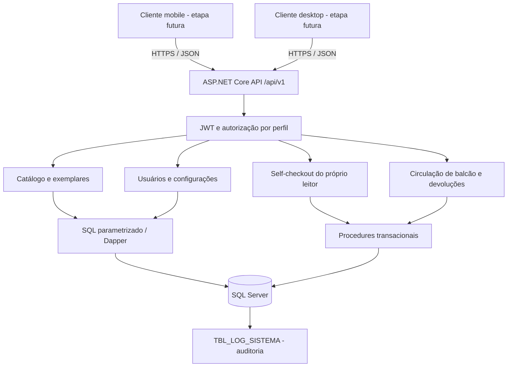
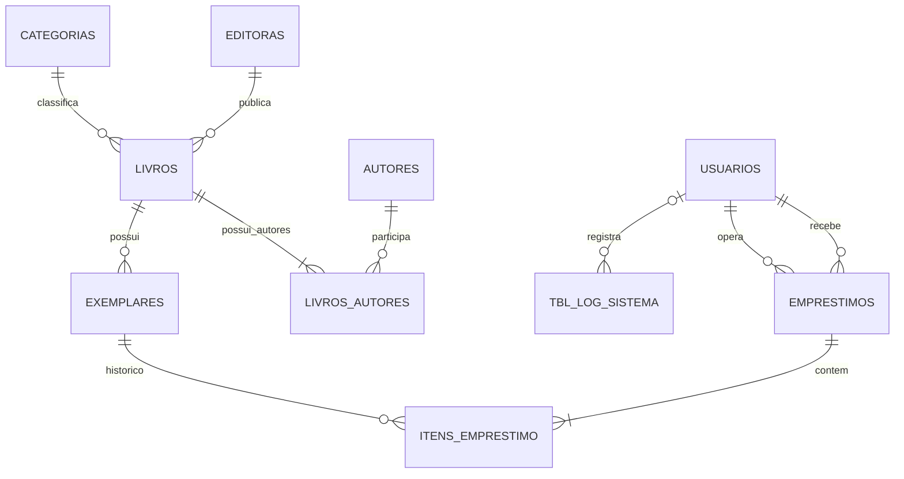

# Arquitetura v0.2 - implementação da API

Data: 01/10/2026. Stack aprovada: C# / ASP.NET Core, banco SQL Server. Este documento atualiza o rascunho v0.1 com o requisito de self-checkout.

## Componentes

Há um único processo de API, dividido em módulos. As telas não acessam o banco. O self-checkout identifica o leitor pela sessão, rejeita `idUsuario` no corpo e confirma todos os exemplares numa transação. A consulta por código pode ser usada por digitação, leitor USB ou futura câmera.

## Relacionamentos

`CONFIGURACOES` guarda uma linha com a política vigente, lida pela transação. As cardinalidades de “ao menos um autor/item” são regras da operação da API; PK/FK isoladas não impõem um filho a toda linha pai. O DDL exato, com campos e restrições, está em `database/001-schema.sql`.

## Decisões de implementação

| Tema | Decisão |
| --- | --- |
| SQL | SQL explícito com Dapper; procedures nas operações de circulação. |
| Id do log | `uniqueidentifier DEFAULT NEWID()`, alinhado ao exemplo do professor. |
| Usuários | Tabela única com perfil e senha hash; sem cadastro público anônimo. |
| Canal | BALCAO ou SELF_CHECKOUT; operador e titular registrados separadamente. |
| Itens | Chave própria, FK para exemplar e data de devolução individual. |
| Empréstimo ativo | Situação ABERTO; FINALIZADO quando não restam itens pendentes. |
| Integridade | Índice único filtrado para exemplar com devolução nula, PK/FK e CHECKs. |
| Concorrência | `sp_getapplock` transacional na circulação, revalidação e rollback integral. |
| Histórico | Sem endpoint de exclusão de movimentações; usuários/exemplares podem ser inativados. |
| UTC | Instantes gravados em UTC, serializados com sufixo Z. |
| API | JSON estrito, erros Problem Details, paginação e OpenAPI com Bearer JWT. |

Os campos de redes sociais e celular do quadro foram deixados fora do MVP. Reservas, renovação, multas, câmera, RFID, interface visual e publicação são etapas posteriores. Os clientes mobile/desktop poderão consumir os mesmos endpoints.

## Fontes técnicas

- [OpenAPI no ASP.NET Core](https://learn.microsoft.com/aspnet/core/fundamentals/openapi/aspnetcore-openapi?view=aspnetcore-10.0)
- [Autenticação e autorização em Minimal APIs](https://learn.microsoft.com/aspnet/core/fundamentals/minimal-apis/security?view=aspnetcore-10.0)
- [Dapper - repositório oficial](https://github.com/DapperLib/Dapper)

As fotos de aula fornecidas pelo usuário orientaram o modelo relacional e o uso de transações/procedures; as extensões de perfis, canal e política estão documentadas acima.
